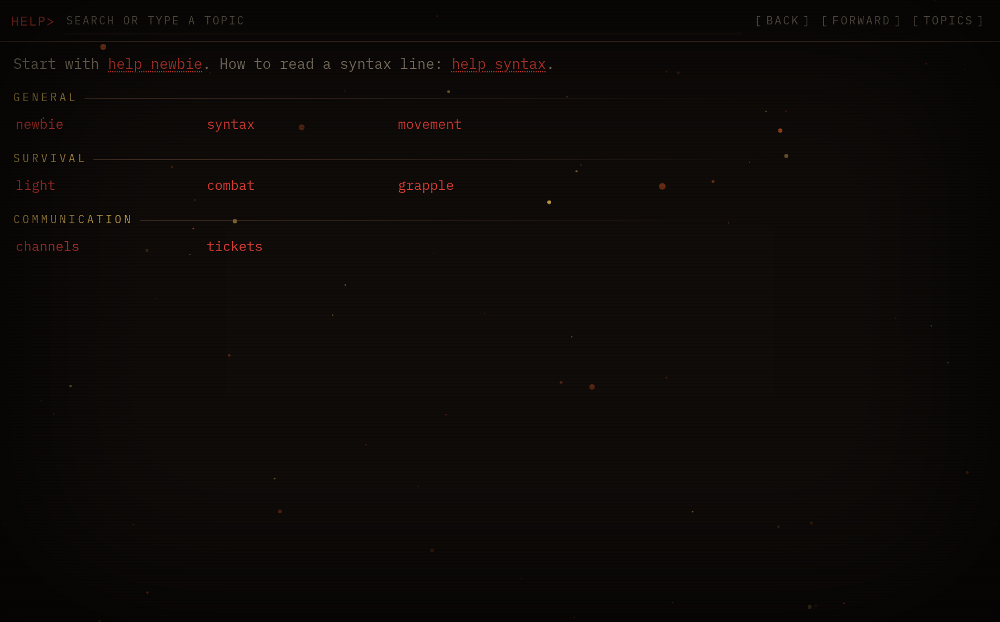
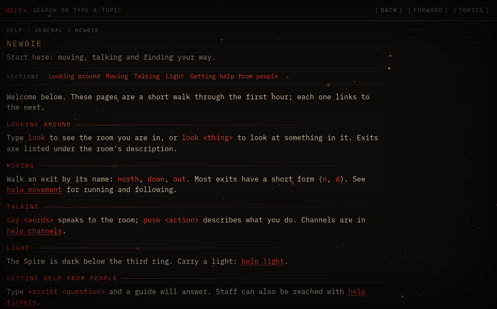
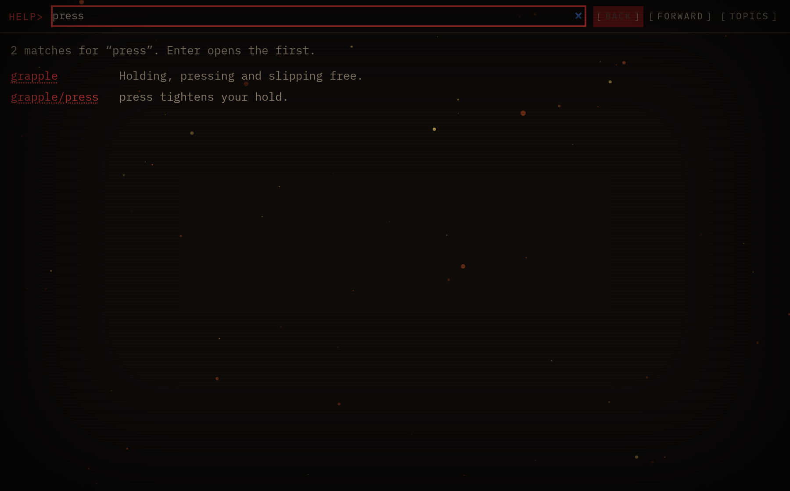
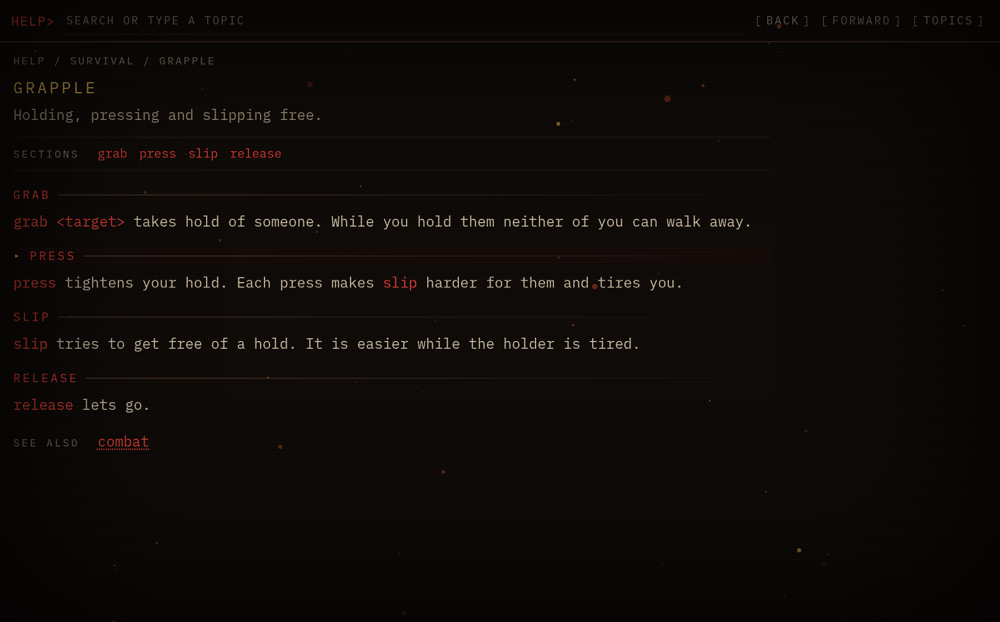
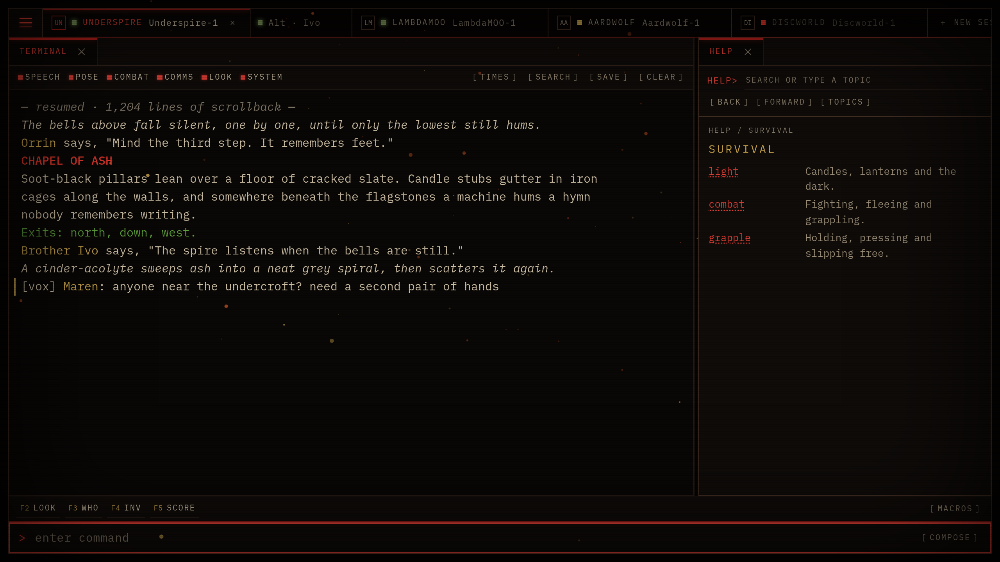

# Help

The game's help in its own panel, for [μClient](https://runmu.sh). You get topics, search as you type,
sections, cross-references and Back/Forward history. Typing `help` sends you there too.



| | |
|---|---|
|  |  |
|  |  |

## What it does

- **A Help panel** for each session. It has a `HELP>` field, `[ BACK ]` `[ FORWARD ]` `[ TOPICS ]`, a breadcrumb, a
  Sections list on longer topics and a "See also" row. Every `help <topic>` reference is a link.
- **Search as you type.** Enter opens the first match. Esc clears the field and brings back the page you were on.
- **Typed help goes to the panel.** `help`, `help <topic>`, `help <topic>/<section>`, `help category <name>` and
  `helpsearch <words>` open in the panel instead of scrolling the terminal. Turn this off in
  Settings → Text → **Help in its own panel**. In screen reader mode help always stays in the terminal.
- **F1** opens Help. It is also in the ☰ menu. In Ctrl+K, `?` followed by a topic name lists matching topics.
  Right-click a word or a selection in the terminal and choose **Look up in Help**.
- **History and a cache.** The last 60 pages are kept, so Back and Forward are instant. If the game doesn't
  answer, the cached page is shown.

## Where the pages come from

The extension picks a source for each session (Settings → Extensions → Help → **Help source**):

| Source | When |
|---|---|
| **GMCP `Client.Help`** | The game implements the package described below. |
| **GMCP `Help` (Evennia)** | Evennia games whose webclient help uses `Help.View` / `Help.Search`. |
| **Text** | Neither. The extension sends your help command, captures what the game prints (up to the next prompt), and shows it in the panel with `help <word>` references linked. |

**Automatic** is the default. It uses what the game has already sent. Otherwise it asks the game. MSSP
`CODEBASE` decides which dialect it tries first. If neither dialect answers, it falls back to text. A game whose
help verb isn't `help` (`@help`, `info`, …) can set **Help command** for its world.

## For game authors: `Client.Help 1`

The client declares `Client.Help 1` in `Core.Supports`. Every message is JSON.

| Message | Direction | Body |
|---|---|---|
| `Client.Help.Get` | client → game | `{ "query": "combat", "req": 81234 }`. An empty query is the index. |
| `Client.Help.Search` | client → game | `{ "query": "grab", "req": 81235 }` |
| `Client.Help.Page` | game → client | A page (below), with the same `req` |
| `Client.Help.Results` | game → client | A `search` page, with the same `req` |
| `Client.Help.Prefs` | client → game | `{ "panel": true }`: whether the player wants typed `help` in the panel |

A `Client.Help.Page` **without** a `req` is the game routing a typed `help` to the panel, and the panel opens.
So when the player has `panel: true`, you can answer their typed `help` with a page and print nothing.

### Pages

```jsonc
{ "kind": "index", "categories": [ { "name": "General", "topics": [ { "key": "newbie", "summary": "Start here." } ] } ] }
{ "kind": "category", "query": "category general", "category": "General", "topics": [ { "key": "newbie" } ] }
{ "kind": "topic", "query": "grapple", "topic": {
    "key": "grapple", "category": "Survival", "summary": "Holding and slipping free.", "aliases": ["hold"],
    "intro": "Optional text above the sections.",
    "sections": [ { "title": "press", "body": "\u0002press\u0003 tightens your hold.", "syntax": ["press"] } ],
    "links": ["combat"] } }
{ "kind": "section", "query": "grapple/press", "section": "press", "topic": { "...": "as above" } }
{ "kind": "search", "query": "grab", "hits": [ { "query": "grapple/grab", "key": "grapple", "section": "grab", "snippet": "…" } ] }
{ "kind": "not_found", "query": "xyzzy", "hits": [], "suggestions": [ { "label": "help newbie", "query": "newbie" } ] }
```

- **Bodies** are plain text. Blank lines separate paragraphs, and a paragraph's lines are joined and reflowed. A line
  that starts with spaces is kept as written. Wrap a cross-reference in `\u0002…\u0003` to make it a link.
- Add `"markup": "pipe"` to a page to use Evennia-style codes instead. `|w…|n` highlights, a highlighted
  `help <topic>` is a link, and `||` is a literal pipe.
- A section is reached as `topic/section`. A topic with four or more sections gets a Sections list.
- The client checks every inbound message against the shapes above. A malformed one is dropped and noted in
  the session log.

### Evennia (`Help.View` / `Help.Search`)

Requests go out as `Help.View {"seq": n, "data": {"query": "…"}}` and `Help.Search` likewise. Answers come back as
`Core.Res [page, n, true]`, with pages in the shapes above and pipe markup. A `Help.View <page>` the game pushes
after a typed `help` updates a Help panel that is already open. It never opens one, because the game printed the
page as well. The client sends `Help.Prefs {"seq": n, "data": {"panel": bool}}` whenever the setting changes.

## For other extensions

```ts
const help = ctx.api<import('@runmu.sh/ext-help').HelpApi>('help');
await help?.open('combat');                       // open the panel on a topic
help?.provideSource(sid, { get: async (q) => ({ kind: 'topic', query: q, topic: { key: q, sections: [] } }) });
```

`open(query?, sid?)`, `show(page, sid?, { markup, open })`, `page(sid?)`, `provideSource(sid, source)` (dispose to
go back to the game's help) and `dialect(sid?)`. The types are in `src/types.ts`.

## Develop

```sh
npm install
npm run build        # dist/index.js, then a manifest check
npm run typecheck
npm test             # unit tests and the extension in a headless μClient host
npm run dev          # dev server on http://localhost:5199/ with hot reload
```

To try a local build, open μClient with `?ext-dev=http://localhost:5199`.

## License

MIT
